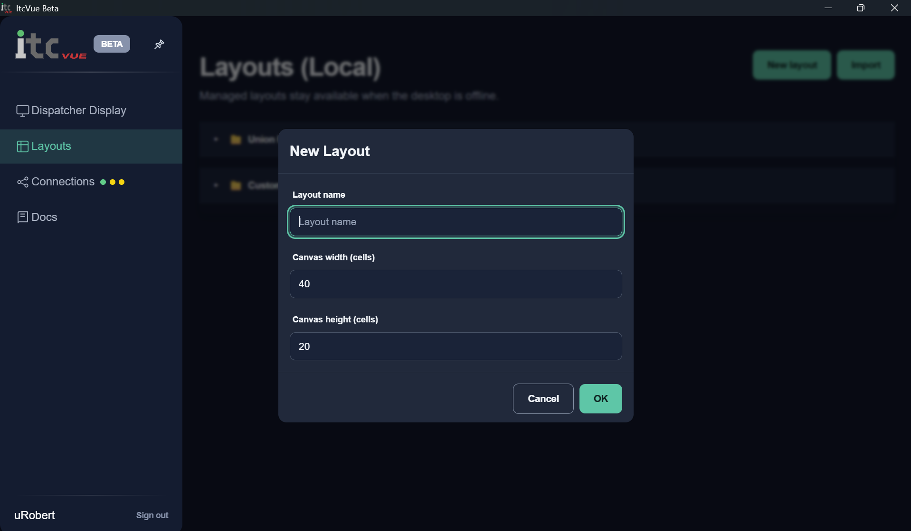
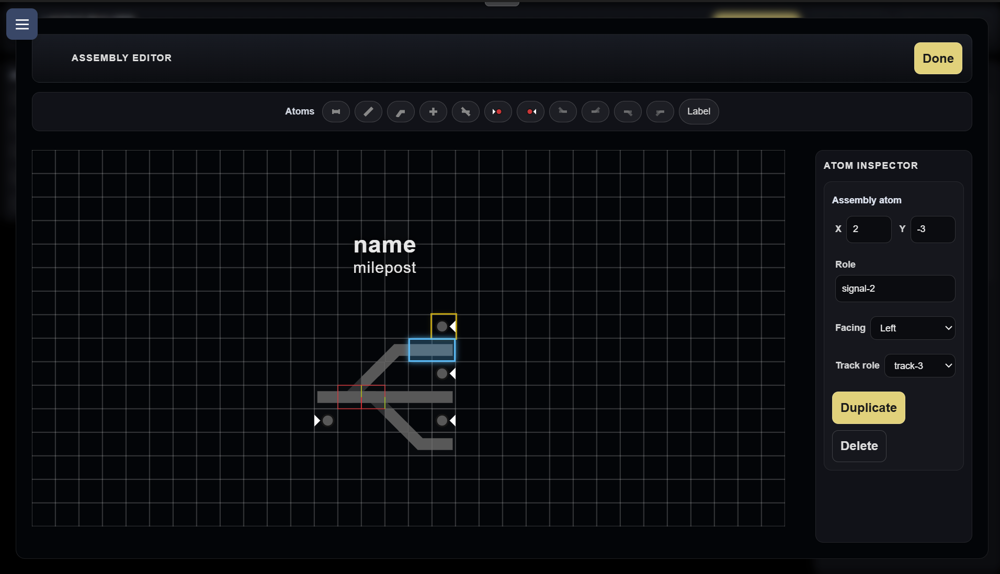
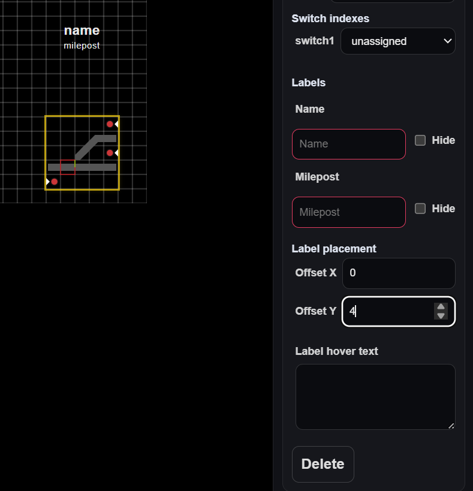
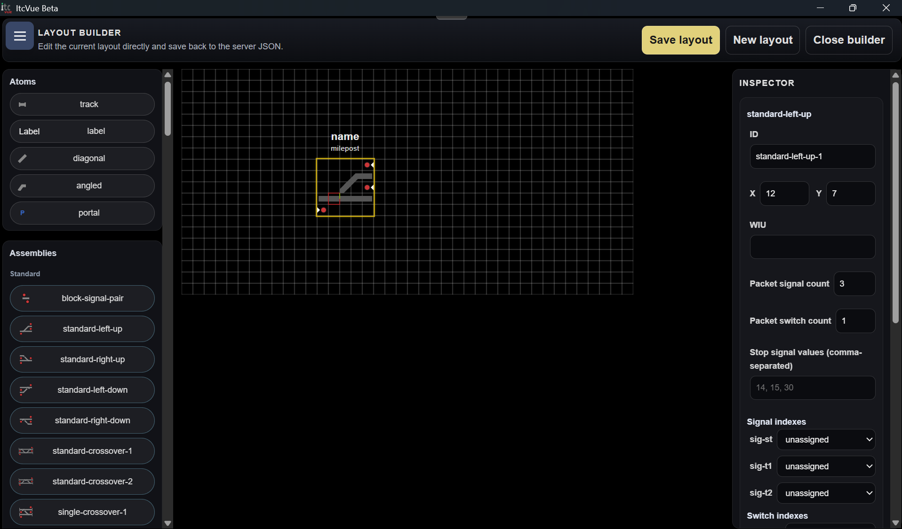
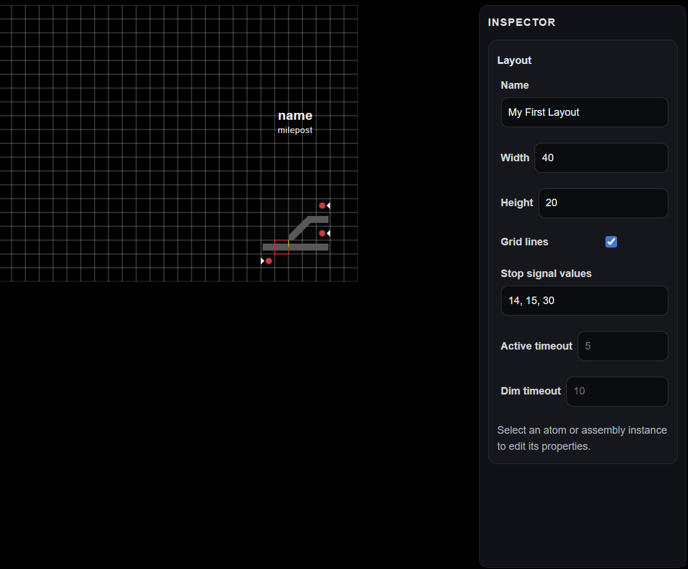

# Layout Builder

Use the builder to create layouts, place atoms and assemblies, and configure live WIU mappings. For design conventions see **Designing and Building Layouts**; for WIU packet and live mapping details see **WIU Mapping and Troubleshooting**; for getting started see **Quick Start**.

## Open, create, and save

Open a layout and choose **Layout builder**. To create one, open **Layouts (Local)**, choose **New layout**, and enter a name and positive whole-number canvas dimensions. **Save layout** saves the draft and returns to monitor mode. **Close builder** or **Return to monitor** leaves without saving; draft edits are discarded.

## Place, select, move, and copy

Drag an atom or assembly from the palette to the canvas; the preview snaps to a cell. Select an item to edit it in the inspector. Use arrow keys to move selection one cell. Hold **Ctrl** while clicking to add items to a selection, or drag on empty canvas to select a group. Move a group by dragging or with arrow keys; it cannot move beyond the canvas.

To copy, right-click an item or group and choose **Copy**, then right-click a destination cell and choose **Paste**. The group keeps its relative spacing; paste is rejected if it will not fit. Keyboard alternative: select items, press **Ctrl+C**, move the pointer to the destination, then press **Ctrl+V**.

| Shortcut / action | Result |
| --- | --- |
| Arrow keys | Move selected item or group one cell |
| Ctrl + click | Add or remove an item in the selection |
| Ctrl + C, then Ctrl + V | Copy selection to the pointer's destination cell |
| Right-click item → **Copy** | Copy item or group |
| Right-click destination → **Paste** | Place copied item or group |

## Understand atoms, assembly definitions, and instances

Atoms are individual symbols such as track, signal, label, crossing, or portal. Assemblies bundle atoms and roles into a reusable definition. An instance is one placed use of that definition.

| | Assembly definition | Assembly instance |
| --- | --- | --- |
| Contains | Reusable atom geometry and unique roles | A reference to a definition at a layout position |
| Edit it to change | Geometry, atom settings, roles, signal-to-track association | Position, WIU identity, counts, mappings, labels, and instance stop values |
| Where | **New assembly** or edit a custom palette entry in Assembly Editor | Select the placed assembly on the layout |
| Effect | Changes the reusable design | Changes this placed use and its live configuration |

Standard assemblies and embedded definitions from imported packages may be read-only. Custom assemblies are editable. Assembly atoms have unique roles such as `track-1` or `signal-2`; roles connect definition geometry with instance labels and packet mappings. Older guides may call assemblies “templates”; that is the former name for the same concept.

In Assembly Editor, **Done** returns to the layout builder. Select an atom to edit it. A newly placed signal may initially associate with a nearby horizontal track: left-facing checks below; right-facing checks above. Inspect its **Track role** and change it when needed. This association is separate from the signal's packet-field mapping.

## Configure an assembly instance

Select an instance to set its display name, optional Name and Milepost labels, WIU ID, total signal and switch counts, role mappings, and optional instance stop values. Mapped indexes start at 1; `unassigned` is a separate choice. Counts describe the entire WIU packet and must match its format. If instances share a WIU, their total counts must agree; review any save-time normalization against the actual packet.

Signal-to-track association belongs to the assembly definition. Signal packet mapping belongs to the instance. If a monitor label is steady bright magenta, check the WIU ID, packet counts, and role mappings; static magenta text is also possible. Select a WIU label in monitor mode to open **WIU Details** and compare available source receipt/observation time, raw bits, and decoded fields. See **WIU Mapping and Troubleshooting** for observation and mapping guidance.

| Instance settings | Additional instance settings |
| --- | --- |
|  |  |

## Edit labels and geometry

| Atom | Main controls | Use |
| --- | --- | --- |
| Track | Length, rotation | Straight horizontal or vertical track; `0` is horizontal and `90` vertical. |
| Switch / signal | Assembly roles and instance mappings | Use an assembly definition for connected geometry; map live fields on its instance. |
| Label | Text, color, position, offsets | Add location, milepost, or other text. |
| Diagonal / angled track | Rotation, flip, **Contain within cell** | Match non-orthogonal rail geometry; inspect joins after containment. |
| Crossing | Atom-specific geometry | Represent a crossing arrangement. |
| Portal | Name | Matching portal names connect layout continuations. |

Inspector fields vary by atom kind. Assembly signal facing and **Track role** are edited in the assembly definition; instance WIU counts and packet mappings are configured on the placed instance.

For labels, the inspector edits text, color, position, and offsets. Main-layout offsets accept half-cell increments. Assembly Editor label offsets offer `-0.5`, `0`, and `0.5`. Protected Name and Milepost identity labels cannot be deleted or have roles/styles changed; reposition them in the editor, then set their values or hide them on the instance. **Label hover text** is separate and appears when hovering over labels in that instance. Clicking a WIU label opens **WIU Details**.

Coordinates use cells: X increases rightward and Y upward. Track rotation uses `0` for horizontal and `90` for vertical. Label offsets use half cells. The layout inspector contains name, width, height, and **Signal stop values**. A decoded value listed as a stop value displays red; other decoded values display green. Instance stop values override layout values; leave the instance field blank to inherit. New layouts start with `14, 15, 30`, which are numeric settings, not universal aspect meanings. Invalid numeric entries are not applied, and dimensions cannot be reduced below the space existing items need.

Track length and rotation, diagonal or angled track controls, **Contain within cell**, and portal names are atom-specific settings. Portals with matching names connect. If track-like atoms overlap in a grid cell, the cell is marked magenta for inspection.

## Save and review

Choose **Save layout** to persist the draft and return to monitor mode. Review the saved view, including WIU labels and any magenta overlap or mapping indications. To abandon edits, close or return to monitor without saving.

