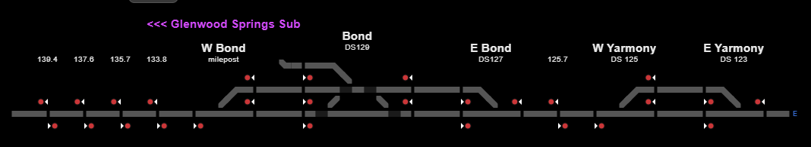
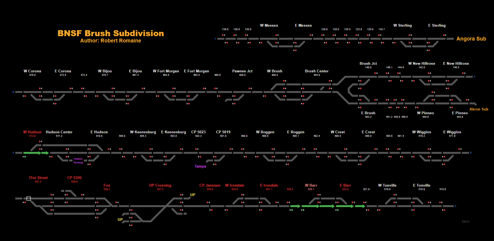
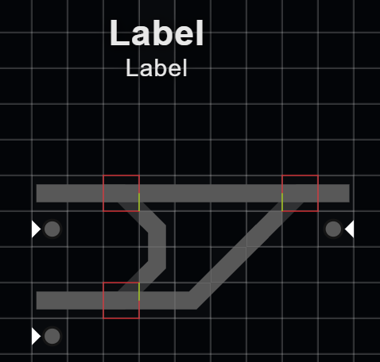
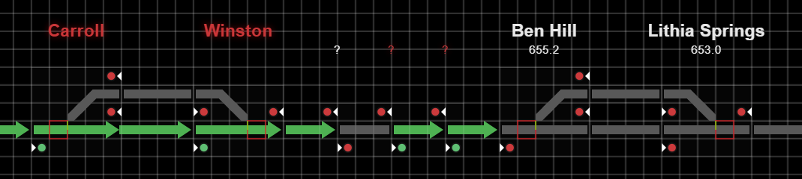
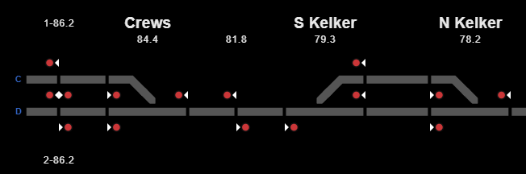
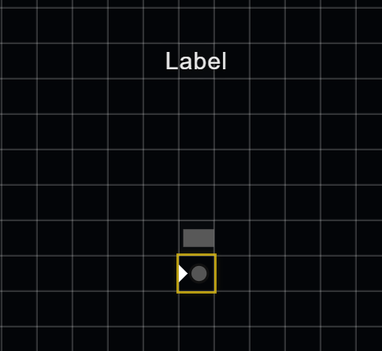

# Designing and Building Layouts

This guide offers conventions for readable, useful territory diagrams. The principle behind them is to make layouts usable and consistently readable from territory to territory, so users can move between territories without relearning how information is presented. None of these suggestions are hard rules: use common sense and let the needs of monitoring govern the design. For monitor basics see **Quick Start**; for builder controls see **Layout Builder**; for observed WIU mapping and troubleshooting see **WIU Mapping and Troubleshooting**.

## Plan useful territory coverage

Orient the diagram to the area's geography so its direction and relationships are easy to understand. A layout is a schematic, not a scale map: bends and distances need not be geographically exact. Use consistent directional labels, and pair portals at row or section boundaries so route continuity is clear.

Here, coverage means the geographical territory represented by the diagram, not the territory served by a server or aggregator. Layouts useful for local field monitoring may be submitted and shared even when aggregator coverage is unavailable. Aim to cover an entire subdivision when practical, or a coherent, useful section rather than an arbitrary cutoff. A layout may extend a few miles into a neighboring subdivision when that context helps explain the territory. The Moffat Tunnel Subdivision layout, for example, extends into Glenwood Springs Subdivision.

*The Moffat Tunnel Subdivision layout extends into Glenwood Springs Subdivision; the boundary is labeled “Glenwood Springs Sub.”*

Meaningful crossings with another railroad, or a connection or merger with another subdivision, can show a few miles of approach when useful to railfans and to understanding the route. Skip incidental features that add no useful context.

Terminal and city layouts can reasonably show multiple railroads; divide them into logical north/south/east/west or other sections when that suits the current builder and viewer, and label connections clearly.

Build from first principles using the territory you observe. Other programs can be research references, but should not determine the layout. Include useful monitoring context such as cardinal directions, track numbers, defect detectors, passenger platforms, location names, and mileposts. Add secondary information as hover text when that keeps the display clear. Avoid clutter or distractions that make the route harder to read.

*Stacking route sections and labeling their portals keeps a long territory compact and oriented.*

## Keep the diagram compact and legible

Use the smallest practical, modular assemblies so more meaningful detail fits in one view. Avoid needless whitespace and layouts that spread excessively wide; stack rows logically and connect them with clearly named portals. About 125 cells wide is a practical readable limit for the current ItcVue on a 14-inch monitor, not a software-enforced maximum. Beyond that, scaling may produce wider margins and rail artwork may begin to look rasterized or pixelated. Favor logical stacked rows and compact assemblies over increasing width. Check the saved monitor view at full monitor scale: labels should not overlap, and the route and important information should remain legible.

Use visible **Name** labels for control points. By default, hide intermediate signal names on the diagram and put a known intermediate name in that instance's **Label hover text**. Intermediate signals are schematic: usually one or two track cells between them is a starting point for showing their order and direction; neighboring larger labels, unusually shaped interlockings, or adjacent geometry may need more room. Prioritize legibility and clear connections over forcing minimum spacing; spacing does not represent actual mileage. Keep useful mileposts visible, using the existing standard label choices of medium for location names and small for mileposts. Prefix mileposts on parallel tracks with `1-` and `2-` to show which track they describe. These are readability guidelines, not required spacing or labeling rules.

*A small reusable assembly keeps common track geometry manageable.*

*Reuse assemblies where the same geometry appears in multiple locations.*

## Represent observed rail geometry

Use track, switch, crossing, diagonal or angled track, and portal atoms to match observed geometry. Omit industrial spurs and decorative details that do not help monitoring; include non monitored track when it provides useful context. Place each signal on the governed direction's right-hand side and set its facing to that direction. Keep assemblies focused and reusable as possible, with distinct roles for their atoms. Use **Contain within cell** when appropriate for diagonal or angled pieces, then inspect joins and remove unintended overlaps without distorting the observed geometry.

*Keep useful mileposts visible and hide intermediate signal names when they would crowd the diagram.*

## Directional intermediate signals

When an intermediate signal faces the correct direction but should not originate a route highlight, create a custom assembly (not a template), add the signal, set its facing, and leave its **Track role** unassigned. Initial placement may assign a role automatically; clear it if populated. Configure the instance WIU and signal index as usual so the signal still updates. This workaround does not change the received value or prevent other route origins from highlighting through the area. See **WIU Mapping and Troubleshooting** for the detailed workaround.

*Use a custom single-signal assembly for this arrangement and leave the signal’s Track role unassigned.*

## Check readiness

Use this advisory review before considering a layout ready for submission. These are guidance points, not automatic acceptance rules or guarantees.

- Does the overview make the territory, orientation, route, and useful endpoints easy to understand?
- Are labels legible at full monitor scale, free of overlaps, and focused on information useful to monitoring?
- Are control-point Name labels visible, intermediate signal names generally kept in Label hover text, and useful mileposts visible? Is intermediate spacing compact and clearly schematic rather than milepost scale?
- Does the diagram represent the full subdivision or a coherent, useful section, with neighbor territory and other railroads included where they provide useful context?
- Are geometry, signals, connections, and portals understandable and consistent with the observed territory?
- Are WIU identities and role mappings accurate? Where reception is available, has live behavior been checked against local or aggregator data, with unknown mappings left explicit rather than inferred?

For technical mapping and live verification steps, see **WIU Mapping and Troubleshooting**.

