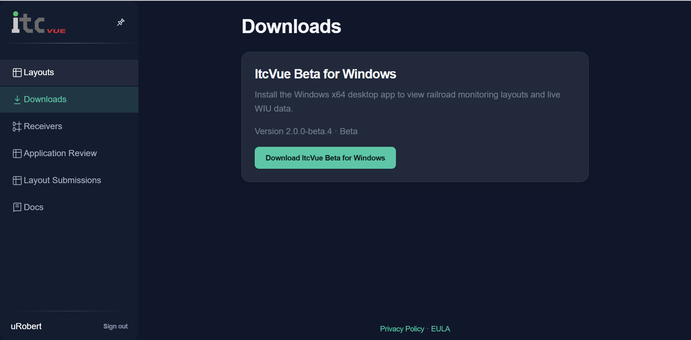
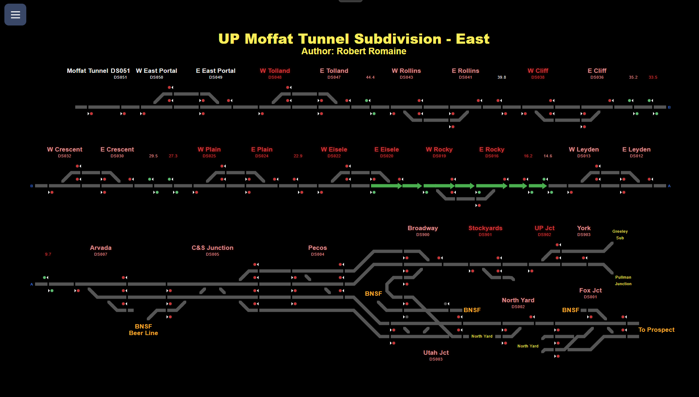
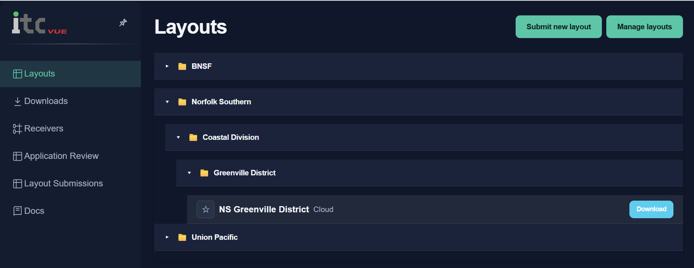
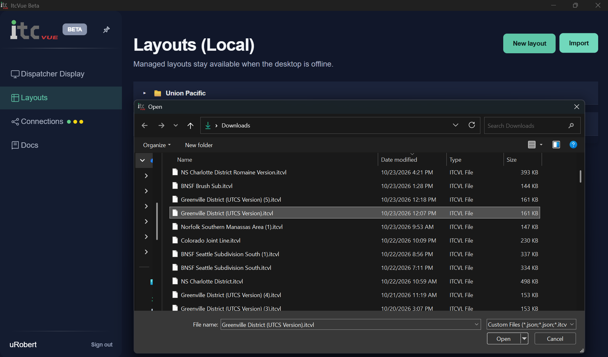
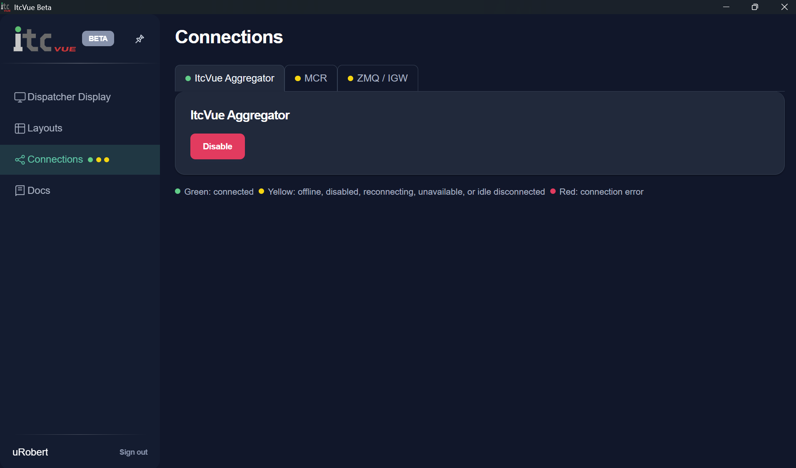

# Quick Start

ItcVue displays railroad layouts and live information from wayside devices. The desktop app opens the **UP Moffat Tunnel Subdivision East** layout automatically, with **ItcVue Aggregator** enabled by default.

## Install ItcVue

On the ItcVue website, open **Downloads**, download the Windows installer, and run it to install ItcVue.

## Open ItcVue for the first time

Start the installed app. **UP Moffat Tunnel Subdivision East** appears automatically in the monitor. Keep ItcVue connected to the internet to receive updates from the default **ItcVue Aggregator** source.

## What you are seeing

The layout diagrams track, signals, switches, and wayside devices. Signal lamps show decoded data and layout configuration. Green track highlights show a route calculated from a green signal and current switch states. A device label can flash red briefly when a packet arrives, then fade as it ages.

This image depicts an eastbound train approaching East Eisele. It has been cleared past East Rocky..

## Download another layout

Download an `.itcvl` file from the website's **Layouts** catalog.

## Import the layout

In the desktop app, open **Layouts (Local)**, choose **Import**, and select the downloaded file. The imported layout opens in the viewer and remains in the local library for later sessions. You can duplicate a read-only layout as a custom layout to edit a copy.

## Optional: connect a different data source

The Moffat example uses **ItcVue Aggregator** by default. To use a local MCR feed, select **MCR**. To use a local IGW feed, enable its configured profile under **ZMQ / IGW**. For IGW setup, see **IGW Setup**.

For layout editing, see **Layout Builder**. For territory planning, see **Designing and Building Layouts**.
